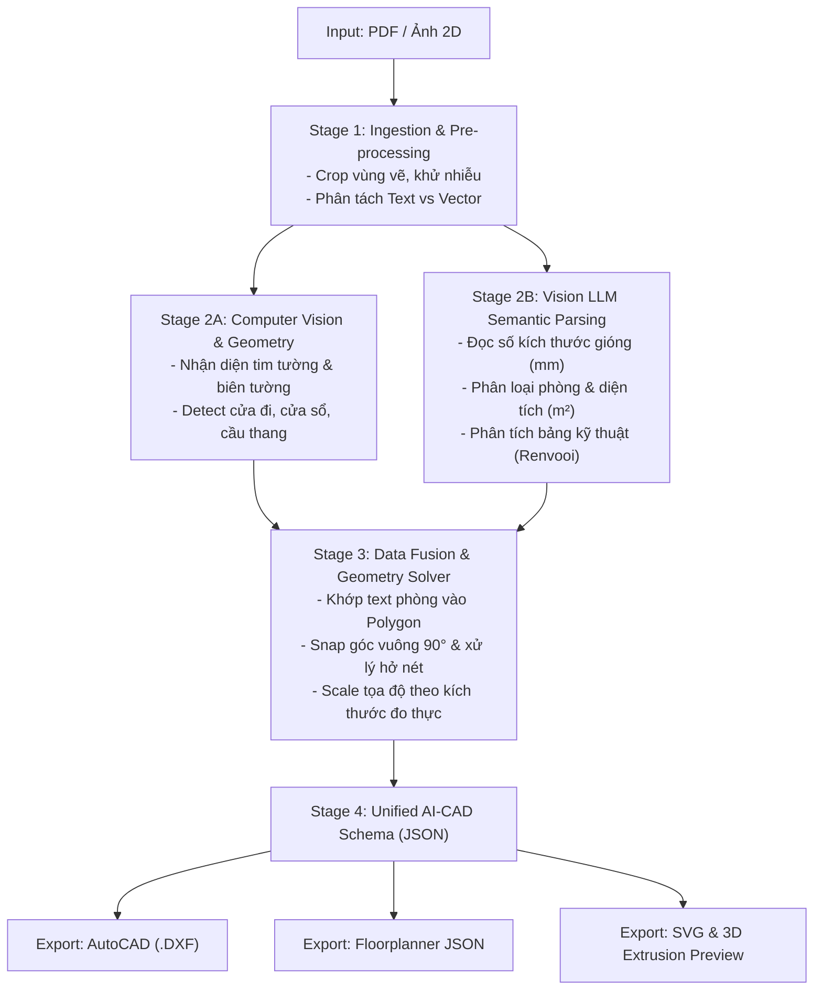

# AI_CAD: AI-Powered Architectural Floor Plan Analysis & Vector CAD Generation

> **Tự động hóa chuyển đổi ảnh thiết kế / PDF 2D thành bản vẽ số CAD (DXF), Floorplanner và 3D BIM bằng trí tuệ nhân tạo.**

[](LICENSE)
[](https://www.python.org/)
[](#)

---

## 📌 1. Giới thiệu tổng quan (Overview)

Trong ngành kiến trúc, xây dựng và bất động sản (AEC/PropTech), hàng triệu bản vẽ mặt bằng nhà ở hiện nay tồn tại dưới dạng **file PDF cũ hoặc ảnh scan 2D**. Để đưa các bản vẽ này vào các phần mềm dựng 3D/thiết kế như **Floorplanner, AutoCAD, SketchUp, Revit**, các chuyên viên hiện nay phải thực hiện thao tác **đồ lại thủ công (manual redrawing)**:
- Đo từng bức tường, vẽ lại từng đoạn thẳng.
- Tìm vị trí cửa đi (doors), cửa sổ (windows) và hướng mở.
- Nhập lại thủ công diện tích, tên phòng và các ghi chú kỹ thuật.

Quy trình này tiêu tốn từ **30 phút đến 3 tiếng cho mỗi mặt bằng căn hộ**, dễ phát sinh sai số do nhập liệu và tốn kém chi phí nhân lực.

**AI_CAD** ra đời nhằm giải quyết triệt để bài toán này bằng cách kết hợp **Computer Vision (Thị giác máy tính) + Vision LLMs (Mô hình ngôn ngữ thị giác đa phương thức) + Thuật toán giải ràng buộc hình học (Geometry Constraint Solver)** để:
1. **Phân tích sâu bản vẽ:** Tự động nhận diện kết cấu tường chịu lực, tường ngăn, cửa đi, cửa sổ, cầu thang và các phòng chức năng.
2. **Hiểu ngữ nghĩa kiến trúc:** Đọc kích thước gióng thực tế (dimension lines), diện tích phòng ($m^2$), cao độ sàn, và bảng ghi chú kỹ thuật (Renvooi / Specifications).
3. **Chuẩn hóa hình học:** Tự động nắn vuông góc ($90^\circ$), khép kín đa giác phòng, gắn đúng tỷ lệ mm theo thực tế.
4. **Xuất file vẽ tự động:** Xuất trực tiếp sang file **AutoCAD (.dxf)**, **Floorplanner (JSON/FML)**, **SVG** và định dạng chuẩn bị cho **IFC/BIM 3D**.

---

## 🏗️ 2. Kiến trúc hệ thống (System Architecture)

Hệ thống hoạt động theo mô hình **Hybrid 5-Stage Pipeline**:



Chi tiết tài liệu kiến trúc kỹ thuật xem tại: [docs/ARCHITECTURE_AND_PLAN.md](docs/ARCHITECTURE_AND_PLAN.md)

---

## 🚀 3. Tính năng cốt lõi (Core Features)

- [x] **Xử lý PDF thông minh:** Tự động bóc tách bản vẽ vector từ các file PDF kích thước lớn có nhiều khoảng trắng thừa.
- [ ] **Nhận diện hệ tường (Wall Extraction):** Tự động bóc tách tường bao (exterior walls) và tường ngăn (interior partition walls), xác định độ dày (100mm, 200mm, 300mm).
- [ ] **Phát hiện lỗ mở (Openings Detection):** Phát hiện cửa đi cánh mở (swing doors kèm cung tròn quét), cửa trượt, cửa sổ.
- [ ] **Bóc tách đa giác phòng (Room Polygon Extraction):** Tự động tính toán diện tích, gán tên phòng (Phòng khách, Phòng ngủ, Bếp, Vệ sinh,...).
- [ ] **Khớp kích thước thực tế (Dimension Alignment):** Đọc chuỗi kích thước số ghi trên bản vẽ để căn chỉnh tỷ lệ 1:1 trong không gian tọa độ CAD (milimet).
- [ ] **Bộ chuyển đổi đa định dạng (Multi-format Exporters):**
  - **DXF:** Phân tách rõ ràng các layer `WALLS`, `DOORS`, `WINDOWS`, `ROOMS`, `TEXT`.
  - **Floorplanner JSON:** Tương thích cấu trúc tường và phòng của Floorplanner.
  - **SVG:** Bản vẽ vector trực quan hiển thị tức thì trên web.

---

## 📂 4. Cấu trúc thư mục dự kiến

```text
AI_CAD/
├── README.md                           # Giới thiệu tổng quan dự án
├── docs/                               # Tài liệu thiết kế & kế hoạch
│   ├── ARCHITECTURE_AND_PLAN.md        # Kế hoạch chi tiết & kiến trúc giải pháp
│   └── DATA_SCHEMA.md                  # Đặc tả chuẩn dữ liệu trung gian (JSON)
├── data/                               # Dữ liệu mẫu & kiểm thử
│   ├── raw/                            # PDF/Ảnh đầu vào mẫu
│   └── outputs/                        # File DXF/JSON/Ảnh sinh ra
├── src/                                # Mã nguồn chính
│   ├── core/                           # Các lớp đối tượng hình học (Point, Wall, Room...)
│   ├── preprocessor/                   # Module tiền xử lý PDF và ảnh
│   ├── vision/                         # Module nhận diện thị giác (OpenCV / Deep Learning)
│   ├── llm/                            # Module tích hợp LLM đọc hiểu ngữ nghĩa & kích thước
│   ├── solver/                         # Bộ giải ràng buộc hình học (Snap 90°, scale mm)
│   └── exporters/                      # Bộ xuất file (DXF, Floorplanner, SVG)
├── tests/                              # Bộ kiểm thử tự động (Unit & Integration tests)
├── requirements.txt                    # Danh sách thư viện phụ thuộc
└── main.py                             # Điểm khởi chạy CLI / Pipeline
```

---

## 🗺️ 5. Lộ trình phát triển (Roadmap)

- **Giai đoạn 1 (Tuần 1 - 2):** Xây dựng Core Schema & Pipeline xử lý PDF Vector trực tiếp (Quick Win với độ chính xác cao).
- **Giai đoạn 2 (Tuần 3 - 4):** Tích hợp Vision LLM (Gemini / Claude / GPT) để bóc tách ngữ nghĩa, số kích thước và thông số kỹ thuật.
- **Giai đoạn 3 (Tuần 5 - 6):** Xây dựng bộ giải hình học (Orthogonal Snapping, Wall Thickness Solver) và xuất file DXF + Floorplanner JSON.
- **Giai đoạn 4 (Tuần 7 - 8):** Mở rộng hỗ trợ ảnh scan raster (Computer Vision / SAM 2 / Floorplan Segmentation) và xây dựng Web UI xem trước 2D/3D.

---

## 👥 Tác giả & Đóng góp
- **Chủ dự án:** Dau Dinh Quang Anh ([@DauDinhQuangAnh](https://github.com/DauDinhQuangAnh))
- Phát triển và kiến trúc kỹ thuật với sự hỗ trợ từ Antigravity AI.
