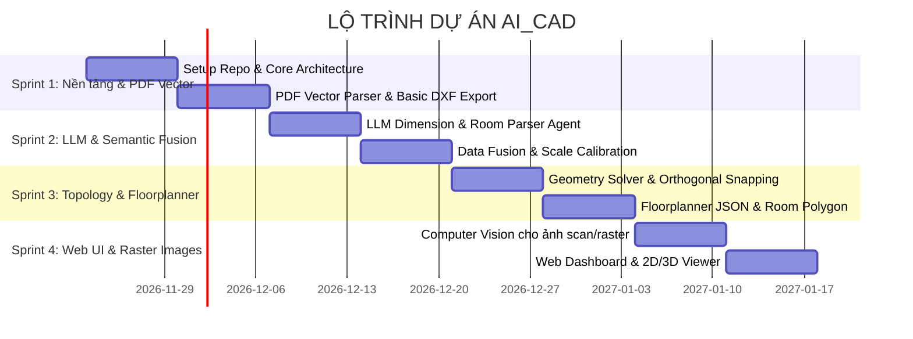

# TÀI LIỆU KIẾN TRÚC KỸ THUẬT VÀ KẾ HOẠCH TRIỂN KHAI DỰ ÁN AI_CAD

> **Dự án:** AI_CAD - Hệ thống tự động phân tích ảnh/PDF mặt bằng kiến trúc và xuất bản vẽ số (AutoCAD, Floorplanner, 3D BIM).  
> **Tác giả:** Dau Dinh Quang Anh  
> **Phiên bản:** 1.0.0 (Tháng 11/2026)

---

## 1. TỔNG QUAN VÀ BỐI CẢNH DỰ ÁN

### 1.1. Bối cảnh
Trong ngành bất động sản, thiết kế nội thất và xây dựng (AEC), nhu cầu chuyển đổi bản vẽ mặt bằng 2D cũ (ảnh chụp, bản scan, file PDF xin phép xây dựng) sang bản vẽ số có thể chỉnh sửa (AutoCAD `.dxf`/`.dwg`, Floorplanner, SketchUp, BIM) là cực kỳ lớn:
- Các chuyên viên đồ họa và kiến trúc sư hiện mất trung bình **30 – 120 phút** để đồ lại thủ công từng căn hộ.
- Việc đồ lại thủ công dễ sai lệch kích thước, nhầm lẫn ký hiệu và tốn kém chi phí nhân sự.

### 1.2. Mục tiêu của AI_CAD
Xây dựng một pipeline tự động hóa thông minh (Automated End-to-End Pipeline) nhận đầu vào là file **PDF bản vẽ** hoặc **ảnh thiết kế mặt bằng** (PNG/JPG), sau đó:
1. Phân tích sâu kết cấu hình học và ngữ nghĩa kiến trúc.
2. Tự động chuẩn hóa kích thước milimet dựa trên các số đo thực tế ghi trên bản vẽ.
3. Xuất ra định dạng bản vẽ chuẩn kỹ thuật:
   - **AutoCAD DXF:** Có đầy đủ layer tường, cửa, cửa sổ, tên phòng, kích thước.
   - **Floorplanner JSON:** Sẵn sàng import vào các công cụ vẽ sàn trực tuyến.
   - **Báo cáo bóc tách mặt bằng (Markdown/JSON):** Thống kê diện tích từng phòng, vật liệu, tiêu chuẩn kỹ thuật.

---

## 2. PHÂN TÍCH TÍNH KHẢ THI VÀ THÁCH THỨC KỸ THUẬT

### 2.1. Đánh giá tính khả thi (Feasibility Analysis)
* **Khả thi cao (High Feasibility):**
  - Với các file PDF xuất xứ từ CAD (PDF vector như file mẫu Hà Lan `test1.pdf`): Có thể trích xuất chính xác $100\%$ các vector đường thẳng, đa giác và chuỗi text số đo mà không cần qua mô hình OCR.
  - Các mô hình Vision LLM hiện đại (Gemini 1.5/2.0 Pro, GPT-4o, Claude 3.5 Sonnet) có khả năng hiểu sơ đồ mặt bằng, nhận biết đâu là phòng ngủ, phòng khách, đâu là đường gióng kích thước rất xuất sắc.
* **Điểm nghẽn cần kiểm soát (Critical Bottlenecks):**
  - **Ảo giác hình học (Geometric Hallucination):** LLM không giỏi sinh tọa độ số chính xác từng pixel. Nếu để LLM tự "đo", các bức tường sẽ bị lệch vài mm hoặc độ dày không đều nhau.
  - **Tính đóng của hình học (Planar Topology):** Trong CAD, một "phòng" phải là một vòng lặp đa giác khép kín ($Closed\ Polygon$). Nếu hai đoạn tường hở nhau $1\text{ mm}$, phần mềm vẽ sàn sẽ không nhận diện được đó là một căn phòng.
  - **Tỷ lệ và xoay (Rotation & Scale):** Cần thuật toán tự động nhận diện hướng bản vẽ (xoay thẳng trục Bắc - Nam hoặc căn song song theo hệ trục $X-Y$) và tính tỷ lệ $1\text{ pixel} = x\text{ mm}$.

### 2.2. Chiến lược giải quyết: Mô hình lai (Hybrid AI Architecture)
Không phụ thuộc hoàn toàn vào LLM, cũng không phụ thuộc hoàn toàn vào Computer Vision truyền thống, AI_CAD áp dụng mô hình lai:
- **Computer Vision & Computational Geometry (OpenCV, Shapely, PyMuPDF):** Chịu trách nhiệm về **độ chính xác hình học** (vị trí tọa độ, tiếp xúc giữa các đoạn thẳng, tính khép kín của phòng, góc $90^\circ$).
- **Vision LLM:** Chịu trách nhiệm về **trí thông minh ngữ nghĩa** (đọc hiểu chữ kích thước, phân loại công năng phòng, phân tích ghi chú vật liệu, nhận diện vùng bản vẽ quan trọng).
- **Constraint Solver:** Ghép hai luồng dữ liệu lại để tối ưu hóa vị trí các điểm nút (vertices) và đoạn thẳng (edges).

---

## 3. THIẾT KẾ KIẾN TRÚC HỆ THỐNG (SYSTEM ARCHITECTURE)

Hệ thống được chia thành 5 module tuần tự (5-Stage Pipeline):

```
┌────────────────────────────────────────────────────────┐
│               STAGE 1: INGESTION & CROP               │
│ - Tự động phát hiện vùng bản vẽ (Bounding Box)          │
│ - Tách bản vẽ khỏi khung viền, khoảng trắng thừa       │
│ - Phân tách PDF Vector Stream vs Raster Image          │
└──────────────────────────┬─────────────────────────────┘
                           │
         ┌─────────────────┴─────────────────┐
         ▼                                   ▼
┌─────────────────────────────┐   ┌─────────────────────────────┐
│  STAGE 2A: GEOMETRY PARSER  │   │   STAGE 2B: SEMANTIC LLM    │
│ - Nhận diện đoạn tường      │   │ - Bóc tách Dimension Text   │
│ - Phát hiện độ dày tường    │   │ - Bóc tách Room Labels      │
│ - Nhận diện Cửa đi / Cửa sổ │   │ - Phân tích RENVOOI / Specs │
│ - Tạo đồ thị kết cấu        │   │ - Đọc cao độ sàn (+PEIL)    │
└──────────────┬──────────────┘   └──────────────┬──────────────┘
               │                                 │
               └────────────────┬────────────────┘
                                │
                                ▼
┌────────────────────────────────────────────────────────┐
│            STAGE 3: FUSION & CONSTRAINT SOLVER         │
│ - Khớp nhãn phòng vào đa giác phòng (Point-in-Polygon) │
│ - Snap các điểm đầu mút tường (Vertex Clustered Snap)  │
│ - Nắn các góc gần vuông về đúng 90° (Orthogonal Snap)  │
│ - Chuẩn hóa tỷ lệ: pixel -> milimet theo kích thước đo │
└──────────────────────────┬─────────────────────────────┘
                           │
                           ▼
┌────────────────────────────────────────────────────────┐
│          STAGE 4: UNIFIED INTERMEDIATE SCHEMA          │
│ - Cấu trúc dữ liệu JSON trung gian chuẩn kỹ thuật      │
│ - Lưu trữ: Tường, Cột, Cửa, Phòng, Kích thước          │
└──────────────────────────┬─────────────────────────────┘
                           │
         ┌─────────────────┼─────────────────┐
         ▼                 ▼                 ▼
┌─────────────────┐ ┌─────────────┐ ┌───────────────────┐
│  AutoCAD (.DXF) │ │ Floorplanner│ │  SVG / 3D Viewer  │
│  Layer tách biệt│ │ JSON format │ │  (Web Browser)    │
└─────────────────┘ └─────────────┘ └───────────────────┘
```

---

## 4. CHI TIẾT TỪNG MODULE KỸ THUẬT

### Module 1: Preprocessor & Region Extractor
- **Mục tiêu:** Cắt gọn trang bản vẽ, loại bỏ các phần trắng thừa (như ví dụ bản vẽ ban đầu có 75% diện tích trắng), tách riêng các tầng (ví dụ: Tầng trệt *Begane grond* và Tầng 1 *1e verdieping*).
- **Thư viện chính:** `pymupdf` (đối với PDF vector) và `opencv-python` (đối với ảnh raster).
- **Đầu ra:** Các sub-view độ phân giải cao cùng ma trận chuyển đổi tọa độ ($Affine\ Transformation$).

### Module 2: Geometry & Topology Parser
- **Mục tiêu:** Phát hiện hệ khung tường và các lỗ mở kiến trúc.
- **Quy trình:**
  1. *Phát hiện đường song song (Parallel Lines):* Tường thực chất là 2 đường song song cách nhau khoảng cách $w$ ($w \approx 100\text{mm}, 200\text{mm}, 300\text{mm}$).
  2. *Trích xuất tim tường (Wall Centerlines):* Chuyển đổi hai biên tường thành một đường tim tường có thuộc tính `thickness`.
  3. *Phát hiện cửa (Door Detection):* Cửa đi trong kiến trúc có ký hiệu đặc trưng là cung tròn $90^\circ$ (quỹ đạo mở cánh) nối với 1 đoạn thẳng (cánh cửa). Cửa sổ là nét đôi/nét mảnh cắt ngang tường.
  4. *Hình thành phòng (Room Planar Subdivision):* Sử dụng thư viện `shapely` để polygonize mạng lưới tim tường thành tập hợp các đa giác kín ($Spaces$).

### Module 3: Semantic LLM Agent
- **Mục tiêu:** Đọc toàn bộ chữ, số đo và ý nghĩa kỹ thuật.
- **Nhiệm vụ:**
  - Bóc tách chuỗi kích thước: `< 6720 >`, `< 9260 >`, `< 3448 >`... kèm hướng gióng ($Horizontal$ hoặc $Vertical$).
  - Bóc tách phòng: Tên phòng, diện tích ghi chú (vd: `winkel 56,73 m²`), cao độ (vd: `-50 +PEIL`).
  - Đọc bảng ghi chú kỹ thuật: Nhận diện loại kết cấu (như *Gyproc GF 205*, *Metal studwanden ms100*).

### Module 4: Constraint Solver & Coordinate Normalization
- **Mục tiêu:** Khử toàn bộ sai số số học và vật lý.
- **Các thuật toán áp dụng:**
  1. **Snap to Grid / Vertex Clustering:** Gộp các điểm đầu mút tường cách nhau dưới $15\text{ mm}$ thành một điểm nút duy nhất để đảm bảo kết cấu tường liền mạch.
  2. **Orthogonal Enforcement:** Nếu một đoạn tường có góc nghiêng trong khoảng $[-3^\circ, +3^\circ]$ so với trục hoành hoặc trục tung, tự động nắn về $0^\circ$ hoặc $90^\circ$ hoàn hảo.
  3. **Scale Factor Estimation:** Sử dụng tối thiểu 3 kích thước gióng đã bóc tách được từ Module 3 để giải phương trình tối ưu tìm tỷ lệ quy đổi thực:
     $$Scale = \frac{\sum (Real\_Dimension_{mm})}{\sum (Pixel\_Length)}$$

### Module 5: Exporter Engine
- **Xuất DXF:** Sử dụng `ezdxf` của Python, thiết lập cấu trúc layer chuẩn kiến trúc:
  - `A-WALL-CORE`: Tim tường và khối tường.
  - `A-DOOR`: Cửa đi và cung mở.
  - `A-GLAZ`: Cửa sổ và vách kính.
  - `A-AREA`: Đa giác ranh giới phòng (Polygon).
  - `A-ANNO-TEXT`: Tên phòng, diện tích, ghi chú.
  - `A-ANNO-DIMS`: Đường gióng kích thước.
- **Xuất Floorplanner JSON:** Tạo tệp JSON khớp với cấu trúc `walls`, `corners`, `doors`, `windows`, `rooms` để có thể load thẳng vào web builder hoặc Three.js renderer.

---

## 5. KẾ HOẠCH TRIỂN KHAI CHI TIẾT (SPRINT ROADMAP)

Dự án được chia thành **4 giai đoạn (Sprints)** kéo dài trong 8 tuần:



### Sprint 1 (Tuần 1 - 2): Nền tảng, Khung dữ liệu & Xử lý PDF Vector (Quick Win)
- **Mục tiêu:** Chạy thành công pipeline đầu vào là file PDF vector (như `test1.pdf`), bóc tách các nét tường và xuất ra file DXF mở được trên AutoCAD.
- **Nhiệm vụ:**
  1. Cấu hình cấu trúc thư mục repo, thiết lập môi trường Python (`requirements.txt`).
  2. Viết module `preprocessor/pdf_extractor.py`: Trích xuất vector lines, curves, text từ PDF bằng PyMuPDF.
  3. Viết module `exporters/dxf_exporter.py`: Ghi các đối tượng `LINE`, `LWPOLYLINE`, `TEXT` ra file `.dxf`.
- **Nghiệm thu Sprint 1:** File `test1.pdf` được bóc tách và xuất ra `test1_output.dxf`, mở được trên Autodesk DWG TrueView hoặc AutoCAD với các nét tường chuẩn xác.

### Sprint 2 (Tuần 3 - 4): Tích hợp Vision LLM & Bóc tách ngữ nghĩa
- **Mục tiêu:** Kết nối API LLM (Gemini / Claude / OpenAI) để bóc tách thông minh các kích thước và công năng phòng.
- **Nhiệm vụ:**
  1. Viết module `llm/dimension_agent.py`: Trích xuất số kích thước từ ảnh và vector text, gán tọa độ gióng.
  2. Viết module `llm/room_agent.py`: Phân loại phòng và đọc diện tích.
  3. Viết module `solver/scale_calibrator.py`: Tính toán tỷ lệ $1\text{ px} = k\text{ mm}$ dựa trên kích thước chuỗi gióng.
- **Nghiệm thu Sprint 2:** Hệ thống tự động in ra bảng tóm tắt diện tích các phòng chính xác $100\%$ so với bản vẽ gốc.

### Sprint 3 (Tuần 5 - 6): Bộ giải hình học & Xuất Floorplanner JSON
- **Mục tiêu:** Đóng kín các phòng thành đa giác, nắn thẳng góc $90^\circ$, xuất file JSON tương thích Floorplanner.
- **Nhiệm vụ:**
  1. Xây dựng bộ giải hình học `solver/orthogonal_snap.py`: Gộp điểm nút (vertex clustering) và ép góc thẳng.
  2. Xây dựng bộ bóc tách phòng `core/room_polygonizer.py` bằng `shapely`: Tìm các chu trình kín (closed cycles).
  3. Xây dựng module `exporters/floorplanner_exporter.py`: Sinh file JSON cấu trúc walls - doors - rooms.
- **Nghiệm thu Sprint 3:** Xuất file JSON có thể load trực tiếp hiển thị sơ đồ phòng 2D và dựng tường 3D.

### Sprint 4 (Tuần 7 - 8): Mở rộng Ảnh Raster & Giao diện Web
- **Mục tiêu:** Hỗ trợ ảnh scan JPG/PNG (không có sẵn vector) và xây dựng giao diện kéo-thả trực quan.
- **Nhiệm vụ:**
  1. Tích hợp mô hình Computer Vision (Canny Edge / Hough Transform / SAM) để trích xuất tường từ ảnh raster.
  2. Xây dựng Web UI đơn giản (Streamlit hoặc FastAPI + Vue/React) cho phép: Kéo thả ảnh $\rightarrow$ Xem preview kết quả $\rightarrow$ Tải file DXF/JSON.

---

## 6. TIÊU CHÍ ĐÁNH GIÁ VÀ ĐO LƯỜNG CHẤT LƯỢNG (METRICS)

Để đảm bảo sản phẩm đạt chất lượng thương mại, các chỉ số sau sẽ được giám sát chặt chẽ:
1. **Wall Intersection Rate (Độ đóng của mạng lưới tường):** $\ge 98\%$ các bức tường giao nhau phải được snap điểm nút kín, không để khe hở vô lý.
2. **Room Detection IoU (Intersection over Union):** Đa giác phòng tạo ra đạt chỉ số $IoU \ge 0.92$ so với ranh giới phòng thực tế.
3. **Dimension Accuracy (Sai số kích thước):** Sai số độ dài các cạnh tường chính so với số ghi trên bản vẽ $\le 1.5\%$.
4. **Processing Time (Thời gian xử lý):** Toàn bộ quy trình bóc tách một mặt bằng diễn ra dưới **30 giây**.

---

## 7. QUẢN LÝ RỦI RO (RISK MANAGEMENT)

| Rủi ro kỹ thuật | Mức độ | Biện pháp phòng ngừa / Khắc phục |
| :--- | :---: | :--- |
| Bản vẽ scan bị nghiêng (skewed) | Cao | Áp dụng thuật toán Deskewing (Hough Transform phát hiện góc nghiêng và xoay lại trước khi nhận diện). |
| Chữ số kích thước bị đè lên nét tường | Trung bình | Sử dụng thuật toán inpainting để xóa text tạm thời khi nhận diện tường, sau đó map lại text sau. |
| Chi phí API LLM cao nếu chạy số lượng lớn | Thấp | Chỉ gửi ảnh crop độ phân giải vừa đủ và sử dụng prompt ngắn gọn có cấu trúc JSON Schema (Structured Output). |
